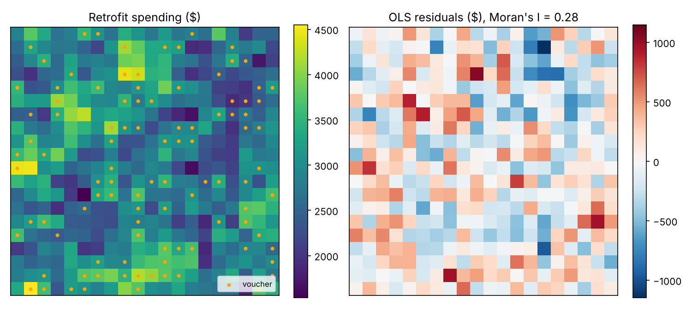

# Neighborhood Retrofit Spillovers

**Household microeconomics meets spatial econometrics.** When one household insulates its walls or installs a heat pump, its neighbors notice: shared contractors, information and social norms make retrofit decisions complements. This project derives a spatial autoregressive (SAR) model from a household network game, simulates 400 households, and shows what a standard regression misses when evaluating a retrofit voucher program.

**▶ Interactive lab:** https://rsabyrbekov.github.io/retrofit-spillovers/ (runs entirely in the browser: exact ML, Moran's I, impact decomposition, and an animated voucher ripple)



## The economics

Household *i* chooses retrofit spending *y<sub>i</sub>* to maximize

$$U_i = a_i y_i - \tfrac12 y_i^2 + \rho\, y_i \sum_j w_{ij} y_j, \qquad a_i = x_i'\beta + \varepsilon_i$$

The first-order condition gives a linear best response, *y<sub>i</sub> = a<sub>i</sub> + ρ Σ<sub>j</sub> w<sub>ij</sub> y<sub>j</sub>*. Stacking households, the unique Nash equilibrium for |ρ| < 1 is the SAR model (Ballester, Calvó-Armengol & Zenou, 2006):

$$y = \rho W y + X\beta + \varepsilon \;\Rightarrow\; y = (I-\rho W)^{-1}(X\beta + \varepsilon)$$

A policy that shifts one household's private return propagates through rounds of best responses. The marginal effect matrix is $\partial y/\partial x_k' = \beta_k (I-\rho W)^{-1}$, which splits into **direct**, **indirect (spillover)** and **total** effects (LeSage & Pace, 2009). With row-standardized *W*, total = β<sub>k</sub>/(1 − ρ).

## The econometrics

| Component | Implementation |
|---|---|
| Spatial weights | Rook contiguity on a 20×20 torus, row-standardized; closed-form eigenvalues ½[cos(2πi/N) + cos(2πj/N)] |
| Estimator | Concentrated maximum likelihood (Ord, 1975), exact log-determinant |
| Inference | Analytic information matrix (Anselin, 1988); 95% profile-likelihood CI for ρ; LR test of ρ = 0 |
| Diagnostics | Moran's I on OLS residuals with permutation inference |
| Impacts | Direct / indirect / total with simulation-based standard errors |
| Validation | Unit tests, including a cross-check against PySAL `spreg.ML_Lag` |

Variables: log household income (spatially sorted, so neighbors' incomes are correlated), homeowner, building age, and a voucher worth $400 given to 25% of households by lottery or in geographic blocks. Spending is in $100s.

## Key results

**One sample** (ρ = 0.55, lottery, `python scripts/run_demo.py`):

| | True | OLS | SAR-ML |
|---|---:|---:|---:|
| Log income | 4.00 | 7.98 (0.51) | 4.40 (0.52) |
| Voucher | 5.00 | 4.91 (0.41) | 4.46 (0.35) |
| ρ | 0.55 | — | 0.53 (0.04) |

Moran's I of OLS residuals = 0.28 (permutation p = 0.001). Per $400 voucher, SAR estimates direct $484 + spillover $463 = **$947 total** (true $1,111); OLS reports only $491.

**Monte Carlo, 300 replications per cell** (`python scripts/monte_carlo.py`). Target: the voucher's total effect, β/(1 − ρ), in $100s.

| Assignment | ρ | True total | OLS mean | OLS RMSE | SAR mean | SAR RMSE | ρ CI coverage |
|---|---:|---:|---:|---:|---:|---:|---:|
| Lottery | 0.00 | 5.00 | 4.96 | 0.34 | 4.94 | 0.42 | 0.95 |
| Lottery | 0.30 | 7.14 | 5.06 | 2.12 | 7.03 | 0.67 | 0.95 |
| Lottery | 0.55 | 11.11 | 5.37 | 5.76 | 10.88 | 1.21 | 0.95 |
| Lottery | 0.75 | 20.00 | 5.93 | 14.09 | 19.45 | 2.67 | 0.92 |
| Blocks | 0.30 | 7.14 | 6.53 | 0.77 | 7.18 | 0.53 | 0.96 |
| Blocks | 0.55 | 11.11 | 8.91 | 2.30 | 11.15 | 0.88 | 0.95 |
| Blocks | 0.75 | 20.00 | 12.99 | 7.08 | 20.00 | 1.80 | 0.94 |

Full table: [`results/monte_carlo.md`](results/monte_carlo.md).

**Takeaways**

1. Under a lottery, OLS recovers roughly the *direct* effect and misses the spillover entirely, understating program impact by a factor of up to 1/(1 − ρ).
2. Under geographic targeting, OLS absorbs part of the spillover through neighbors' vouchers, so the coefficient no longer measures any well-defined effect.
3. OLS also overstates the income effect (≈7.1 vs. 4.0 at ρ = 0.55) because income is spatially sorted and neighbors' spending is omitted.
4. SAR-ML is approximately unbiased and its profile-likelihood intervals have close to nominal coverage.
5. In a linear SAR with row-standardized *W*, the aggregate multiplier does not depend on *where* vouchers land; targeting changes who benefits, not the total. Threshold adoption or contractor capacity constraints would break this, which is the natural extension.

## Repository layout

```
src/retrofit_spillovers/
  dgp.py        # network-game data-generating process, torus weights, eigenvalues
  sar.py        # OLS and exact SAR maximum likelihood with analytic s.e.
  effects.py    # LeSage-Pace direct / indirect / total impacts
  moran.py      # Moran's I permutation test
scripts/
  run_demo.py   # one sample: estimates, impacts, maps
  monte_carlo.py
tests/test_sar.py   # incl. cross-check vs PySAL spreg
docs/index.html     # interactive lab (GitHub Pages)
```

## Quick start

```bash
pip install -r requirements.txt
python scripts/run_demo.py --rho 0.55 --assign random
python scripts/monte_carlo.py --reps 300
pytest -q
```

## References

- Anselin, L. (1988). *Spatial Econometrics: Methods and Models*. Kluwer.
- Ballester, C., Calvó-Armengol, A., & Zenou, Y. (2006). Who's who in networks. *Econometrica*, 74(5), 1403–1417.
- LeSage, J., & Pace, R. K. (2009). *Introduction to Spatial Econometrics*. CRC Press.
- Ord, K. (1975). Estimation methods for models of spatial interaction. *JASA*, 70(349), 120–126.

## Author

**Rahat Sabyrbekov, PhD**: environmental and applied microeconomics, data science. Data is simulated; the framework is designed to be applied to household survey data with geocoded dwellings.

License: MIT
